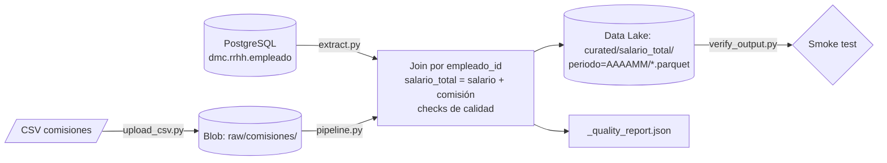
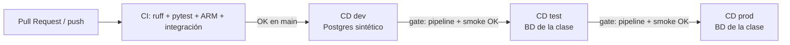

# DataOps – Cálculo de comisiones de empleados

Pipeline automatizado que combina la tabla **`dmc.rrhh.empleado`** (PostgreSQL) con el archivo
**`ComisionEmpleados_V1_AAAAMM.csv`** (Azure Blob Storage), calcula

```
salario_total = mnt_salario + comision
```

y publica una tabla consolidada en **Parquet** en el Data Lake. El pipeline se versiona en Git y se
despliega automáticamente en **dev → test → prod** con **GitHub Actions** (CI/CD).

> Implementación con la alternativa **Python** que permite el enunciado (en lugar de Azure Data Factory).
> El Data Lake es Azure Blob Storage / ADLS Gen2; en CI/CD y en local se usa **Azurite**, el emulador
> oficial de Microsoft, con la misma API. Con una suscripción Azure basta con desplegar la plantilla ARM
> y definir el secret `AZURE_STORAGE_CONNECTION_STRING`: el código no cambia.

## Arquitectura





## Estructura del repositorio

| Ruta | Contenido |
|---|---|
| `src/comisiones/config.py` | Configuración por variables de entorno (sin credenciales en el código) |
| `src/comisiones/extract.py` | Extracción de `rrhh.empleado` con SQLAlchemy |
| `src/comisiones/storage.py` | Lectura/escritura en Blob Storage (Azure o Azurite) o carpeta local |
| `src/comisiones/transform.py` | Lectura del CSV, join, `salario_total`, checks de calidad, Parquet |
| `src/comisiones/pipeline.py` | Orquestador: extract → transform → load + reporte JSON |
| `src/comisiones/upload_csv.py` | Carga el CSV al contenedor `raw` (zona de aterrizaje) |
| `src/comisiones/verify_output.py` | Smoke test post-despliegue sobre el Parquet publicado |
| `tests/` | Pruebas unitarias (10) e integración end-to-end (1) |
| `sql/extract_empleado.sql` | Consulta de extracción |
| `sql/seed_test_db.sql` | Datos **sintéticos** con la estructura de `rrhh` para dev/CI |
| `infra/arm/` | Plantilla ARM del Data Lake (ADLS Gen2 + contenedores) y parámetros por ambiente |
| `scripts/validate_arm.py` | Validación de las plantillas ARM sin suscripción |
| `.github/workflows/ci.yml` | CI: lint, pruebas unitarias, validación ARM, integración |
| `.github/workflows/cd.yml` | CD: dev → test → prod con gates automáticos |
| `.github/workflows/deploy-env.yml` | Workflow reutilizable de despliegue por ambiente |
| `docker-compose.yml` | Postgres + Azurite para el ambiente local |
| `data/` | CSV de comisiones del periodo |

## Reglas de negocio y calidad

- CSV con separador `;` y columna `Nombre y Apellido` en formato `"Nombre, Apellido"` (se separa en `nombre_csv` / `apellido_csv`).
- Join por `empleado_id`. Por defecto **inner** (solo empleados con comisión). Con `JOIN_TYPE=left` se incluyen todos los empleados con comisión 0.
- Columna informativa `excede_tope_comision` (comisión > `mnt_tope_comision`). No modifica el cálculo.
- El pipeline **falla** (y bloquea el despliegue) si: el CSV tiene IDs duplicados/nulos, comisiones no numéricas o negativas, la tabla viene vacía, o `salario_total` no cuadra.
- IDs del CSV que no existen en `empleado` se reportan como advertencia en `_quality_report.json`.

## Salida

```
curated/salario_total/periodo=202610/salario_total_empleados.parquet
curated/salario_total/periodo=202610/_quality_report.json
```

Columnas: `empleado_id, nom_empleado, ape_empleado, cod_cargo, cod_departamento, mnt_salario,
mnt_tope_comision, comision, nombre_csv, apellido_csv, salario_total, excede_tope_comision, periodo,
ambiente, fecha_proceso`.

## Ejecución local

Requisitos: Python 3.10+, Git. Opcional: Docker Desktop o Node.js (para Azurite).

```bash
python -m venv .venv
# Windows: .venv\Scripts\activate    |  Linux/Mac: source .venv/bin/activate
pip install -r requirements-dev.txt
pip install -e .
cp .env.example .env          # Windows: copy .env.example .env

pytest                        # pruebas unitarias
python scripts/validate_arm.py
```

**Opción A – todo local con Docker** (Postgres sintético + Azurite):

```bash
docker compose up -d
python -m comisiones.upload_csv data/ComisionEmpleados_V1_202610.csv
python -m comisiones.pipeline --env dev
python -m comisiones.verify_output --env dev --download-dir evidencia
```

**Opción B – base de la clase**: en `.env` define `PG_HOST`, `PG_USER`, `PG_PASSWORD` con los datos
del curso y, si no tienes Docker, `STORAGE_MODE=local` (el Data Lake se simula en `./datalake`).
Luego ejecuta los mismos tres comandos.

## CI/CD (GitHub Actions)

| Workflow | Disparador | Qué hace |
|---|---|---|
| **CI** | PR a `main`, push a `main`/`develop` | `ruff`, 10 pruebas unitarias + cobertura, validación ARM, prueba de integración con Postgres + Azurite |
| **CD** | CI exitoso en `main` o manual | `dev` → `test` → `prod`. En cada ambiente: carga CSV a `raw`, ejecuta pipeline, smoke test, publica evidencias |

**Aprobaciones automatizadas (gates):** `dev` solo corre si CI pasó; `test` solo si `dev` pasó
pipeline + smoke test; `prod` solo si `test` pasó. Cualquier fallo de calidad detiene la promoción.

### Configuración en GitHub

1. *Settings → Environments*: crear `dev`, `test`, `prod`.
2. En `test` y `prod`, *Environment secrets*:
   `PG_HOST`, `PG_PORT`, `PG_USER`, `PG_PASSWORD` (datos de la BD de la clase).
3. Opcionales (*Variables*): `CSV_BLOB_NAME`, `JOIN_TYPE`, `USE_SEED_DB=true` (usa Postgres sintético
   si la BD de la clase no es accesible desde GitHub).
4. Opcional: secret `AZURE_STORAGE_CONNECTION_STRING` para escribir en un Storage Account real.

## Despliegue de infraestructura (ARM)

```bash
az group create -n rg-comisiones-dev -l eastus2
az deployment group create -g rg-comisiones-dev \
  --template-file infra/arm/azuredeploy.json \
  --parameters @infra/arm/azuredeploy.parameters.dev.json
```

Repetir con `test` / `prod`. La salida `storageAccountName` identifica la cuenta; su cadena de conexión
va al secret `AZURE_STORAGE_CONNECTION_STRING` del ambiente correspondiente.

## Seguridad

- Credenciales solo en `.env` (ignorado por Git) o GitHub Secrets.
- Usuario de BD de solo lectura.
- Plantilla ARM: TLS 1.2, solo HTTPS, sin acceso público a blobs.
